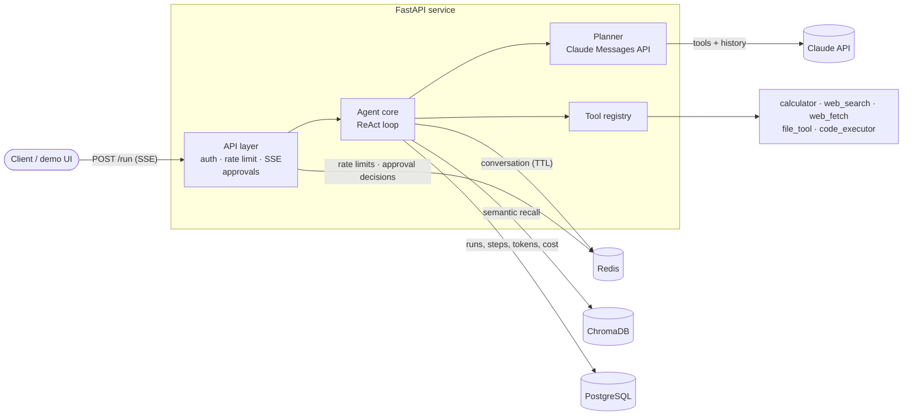
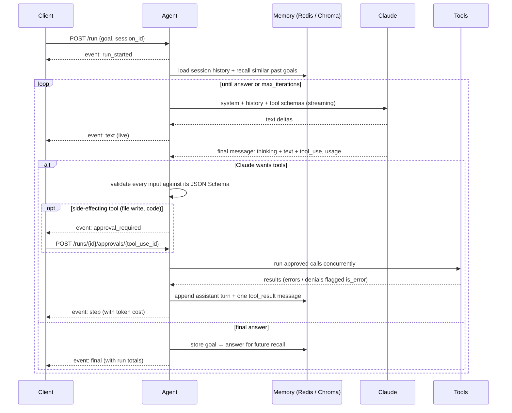

# AI Agent — a ReAct agent built from scratch on the Claude API

[](https://github.com/samandar-hamrayev/ai-agent/actions/workflows/ci.yml)


An autonomous agent that reasons, calls tools, and remembers — **without LangChain or any agent framework**.
The loop, tool registry, memory layers, persistence and streaming API are all written by hand so every
moving part is visible and testable.

> Ask it *"Find the Python release schedule, tell me when 3.14 reaches end of life and save a note"* and
> watch it search, read the page, ask **your approval** before writing the file, and answer — text streamed
> token by token over Server-Sent Events, with the run's token cost at the end.

<!-- DEMO: record the built-in UI at http://localhost:8000, save it as docs/demo.gif, then replace this comment with:
<p align="center"></p>
-->

---

## Why build it from scratch?

Frameworks hide the parts that break in production: how tool calls are replayed, what happens when the
history window cuts a `tool_use` away from its `tool_result`, how a blocking tool affects an async server,
where state lives between requests. This project implements each of those explicitly:

- **ReAct loop** with parallel tool calls, an iteration budget, and clean handling of refusals and API errors
- **Human-in-the-loop** — side-effecting tool calls pause the run until a person approves or denies them
- **Token streaming** — Claude's text arrives as it is written; tool inputs are schema-validated before they run
- **Cost accounting** — tokens, cache hit rate and USD cost per step and per run, stored in PostgreSQL
- **Evals** — a task suite with deterministic checks that reports accuracy, steps, latency and cost
- **Two-tier memory** — Redis for the live conversation, ChromaDB for semantic recall across sessions
- **Durable run history** in PostgreSQL (async SQLAlchemy + Alembic) — every run and step is queryable
- **Security that is honest about its limits** — SSRF-guarded fetching, path-confined files, resource-limited code execution

## Architecture



### One run, step by step



## Design decisions

| Decision | Why |
|---|---|
| **Assistant turns are replayed verbatim** (thinking, text and `tool_use` blocks stored as JSON objects) | The API needs real `tool_use` blocks to pair with `tool_result`s, and thinking blocks must be passed back unchanged. Storing them as a string would make Claude read its own tool calls as plain text. |
| **All tool calls of a turn run concurrently; results go back in one user message** | Claude can request several tools at once. Splitting results across messages breaks the pairing and teaches the model to stop parallelising. |
| **History is trimmed at turn boundaries** | Redis `LTRIM` keeps the last N messages, which can orphan a `tool_result`. The API view always starts at a real user message. |
| **Async end-to-end** (`AsyncAnthropic`, `redis.asyncio`, async SQLAlchemy) and blocking tools/Chroma on worker threads | One slow tool or search must not stall every other stream on the server. |
| **Postgres is optional** (`NullRunStore` when `DATABASE_URL` is unset) | The agent runs locally with only Redis; history is an add-on, not a dependency of the loop. |
| **Stable, cache-friendly prompt** — no timestamps or IDs in the system prompt, tools sorted by name, `cache_control` on the system block | Prompt caching is a prefix match; any per-request byte in the prefix would invalidate it. |
| **Adaptive thinking + `effort`**, server-side refusal fallback (beta) | Lets the model decide how much to think per step; `LLM_EFFORT` trades depth for cost. Fallbacks can be switched off with `LLM_FALLBACKS=false`. |
| **Approvals go through Redis, not process memory** (pending key + `BLPOP`, single-use `GETDEL`) | The SSE stream and the POST carrying the decision can hit different workers. A timeout counts as a denial, and a denial is returned to Claude as a tool error so it can adapt. |
| **Eager tool-input streaming + our own JSON Schema validation** | Large inputs (file contents, code) stream as they are generated, which means the API no longer validates them — so the registry does, before anything runs. Calls cut off by `max_tokens` or a refusal are dropped, never executed. |
| **Disconnects close open tool calls** | If the client goes away mid-step, every unanswered `tool_use` gets a `tool_result`, so the session's history stays valid for the next request. |
| **Cost from `usage`, per attempt** | With server-side fallbacks one response can include several model attempts; each is billed at its own model's price, cache reads/writes at their multipliers. The cache hit rate is the number that proves caching works. |
| **Rolling cache breakpoint** on the conversation, plus one on the system prompt | Each loop iteration re-reads everything so far from cache instead of paying for it again. |
| **Failures become data, not exceptions** | Tool errors are returned to Claude with `is_error: true` so it can recover; API errors end the run with a clear status that is persisted. |

## Tech stack

| Layer | Technology |
|---|---|
| LLM | Anthropic Claude API — tool use, adaptive thinking, prompt caching |
| API | FastAPI, Server-Sent Events (`sse-starlette`), Pydantic v2 / pydantic-settings |
| Short-term memory | Redis (`redis.asyncio`) — per-session history with TTL, rate limiting |
| Long-term memory | ChromaDB — cosine similarity over past goal/answer pairs |
| Persistence | PostgreSQL, SQLAlchemy 2 (async, `asyncpg`), Alembic migrations |
| Quality | pytest (+ fakeredis, aiosqlite), ruff, pre-commit, gitleaks |
| Delivery | Docker (multi-stage, non-root, read-only FS), docker compose, GitHub Actions, Dependabot |

## Quick start

### With Docker (recommended)

```bash
git clone https://github.com/samandar-hamrayev/ai-agent.git
cd ai-agent
cp .env.example .env          # set ANTHROPIC_API_KEY and POSTGRES_PASSWORD
docker compose up --build -d
```

Open **http://localhost:8000** for the live demo UI, or **http://localhost:8000/docs** for the OpenAPI docs.
Migrations run automatically on start.

### Locally

```bash
make install                  # .venv + dev dependencies + pre-commit hooks
docker compose up -d redis postgres
make migrate
make run                      # uvicorn with --reload on :8000
```

## API

| Method | Path | Description |
|---|---|---|
| `POST` | `/run` | Run the agent; streams `run_started` → (`text`* `approval_required`* `step`)* → `final` (or `error`) |
| `POST` | `/runs/{run_id}/approvals/{tool_use_id}` | `{"approve": true\|false, "reason": "…"}` — decide a pending tool call (single use) |
| `GET` | `/runs?session_id=&limit=` | Recent runs with token usage and cost |
| `GET` | `/runs/{run_id}` | A run with all of its steps, tool calls, approvals and per-step usage |
| `DELETE` | `/sessions/{session_id}` | Forget a session's conversation |
| `GET` | `/tools` | Registered tools and their JSON schemas |
| `GET` | `/health` | Redis / Postgres status |

```bash
curl -N -X POST localhost:8000/run \
  -H 'Content-Type: application/json' \
  -d '{"goal": "What is (17*23) + 4**5?", "session_id": "demo"}'
```

```text
event: run_started
data: {"run_id": "6f1c…", "session_id": "demo"}

event: text
data: {"step_number": 1, "text": "I'll compute "}

event: step
data: {"step_number": 1, "actions": [{"tool_name": "calculator", "tool_input": {"expression": "(17*23) + 4**5"},
       "success": true, "result": "SUCCESS: 1415", "approval": "not_required"}], "usage": {"cost_usd": "0.0119", …}}

event: final
data: {"step_number": 2, "is_final": true, "final_answer": "(17×23) + 4⁵ = 1415.",
       "run_usage": {"input_tokens": 412, "cache_read_tokens": 3880, "cost_usd": "0.0213", …}, …}
```

Reuse the same `session_id` to continue a conversation; set `API_KEY` to require an `X-API-Key` header.

## Configuration

All settings are environment variables (see [`.env.example`](.env.example)).

| Variable | Default | Purpose |
|---|---|---|
| `ANTHROPIC_API_KEY` | — | Claude API key |
| `LLM_MODEL` | `claude-opus-5` | Model ID |
| `LLM_EFFORT` | `high` | `low` · `medium` · `high` · `xhigh` · `max` |
| `LLM_FALLBACKS` | `true` | Server-side refusal fallback (beta) |
| `MAX_ITERATIONS` | `10` | ReAct iteration budget per run |
| `REDIS_URL` | `redis://localhost:6379/0` | Conversation memory + rate limiter |
| `DATABASE_URL` | unset | Enables run history (`postgresql+asyncpg://…`) |
| `ENABLE_CODE_EXECUTOR` | `false` | Registers the Python execution tool |
| `REQUIRE_APPROVAL` | `true` | Pause for a human before file writes / code execution |
| `APPROVAL_TIMEOUT_SECONDS` | `300` | After this, a pending call counts as denied |
| `API_KEY` | unset | Require `X-API-Key` on every request |
| `RATE_LIMIT_PER_MINUTE` | `20` | Per client, `0` disables |
| `CORS_ORIGINS` | `["http://localhost:8000"]` | Allowed browser origins |

## Tools

| Tool | What it does | Safety |
|---|---|---|
| `calculator` | Arithmetic via an AST walker | No `eval`; exponent capped |
| `web_search` | DuckDuckGo HTML results (no API key) | 15 s timeout, top 5 results |
| `web_fetch` | Reads a page as clean text, in chunks (`start_index`) | SSRF guard on every redirect hop, http(s) only, 2 MB / text types only |
| `file_tool` | Read/write text files | Confined to `WORKSPACE_DIR`; `..`, absolute paths, sibling-prefix dirs and symlink escapes are rejected; **writes need approval** |
| `code_executor` | Runs a Python script | Opt-in, **needs approval**; see below |

Adding a tool means subclassing `BaseTool` (name, description, JSON schema, `run`) and registering it — the
registry turns it into a Claude tool definition and validates inputs against the schema. Set
`requires_approval = True` (or override `needs_approval(input)`) for anything with side effects.

## Security model

- **Secrets** come only from the environment; `.env` is git- and docker-ignored; gitleaks runs in pre-commit and CI.
- **Container**: non-root user, read-only root filesystem, `no-new-privileges`, all Linux capabilities dropped.
- **API**: optional API key (constant-time comparison), per-client rate limit in Redis, restricted CORS, input validation on goal and session id.
- **Human approval** for side-effecting tools; decisions are single-use and expire; silence means "no".
- **SSRF**: `web_fetch` only reaches hosts that resolve to public addresses (no loopback, private ranges, link-local / cloud metadata, embedded credentials) and re-checks each redirect. Residual risk: DNS rebinding between the check and the connection — a network egress policy closes that gap in production.
- **Code execution is defence in depth, not a sandbox.** The child process gets an empty environment, isolated mode (`-I -S`: no site-packages), a throwaway directory and rlimits on CPU, memory, file size and open files. It still runs as the same OS user as the API, so a determined script could read that process's memory or `/proc`. That's why it is **off by default**; a production deployment would run it in a separate, network-less container (gVisor / Firecracker) or use Anthropic's server-side code execution tool.

## Testing

```bash
make test        # fast suite: no network, no embedding model download
make test-all    # + ChromaDB integration tests
make lint
```

The suite (140+ tests) drives the full loop with a scripted planner — streaming, approvals (approve / deny /
timeout / client disconnect), usage accounting — with real Redis semantics (fakeredis), a real SQL store
(SQLite), the HTTP layer through `httpx.ASGITransport`, and `web_fetch` against a mock transport. CI also runs Alembic
upgrade → downgrade → upgrade against PostgreSQL, builds the Docker image and scans history for secrets.

## Evals

Unit tests prove the code works; evals measure how well the *agent* works. `evals/tasks.json` holds tasks
with deterministic checks — numeric answers, text, files written, and safety cases (reading `/etc/passwd`,
fetching cloud metadata) that must fail.

```bash
make eval                                   # all tasks, real API (budget-capped, default $2)
.venv/bin/python -m evals.run --tags math --effort medium
.venv/bin/python -m evals.run --model claude-sonnet-5 --offline
```

Each run prints a table and saves `evals/results/<time>-<model>-<effort>.json` with accuracy, average
steps, latency, tokens, cache hit rate and cost — so a prompt, model or effort change is a measured
comparison rather than a guess.

<!-- EVAL RESULTS: paste the summary table from your first run here. -->

## Project structure

```text
agent/
  config.py        settings (pydantic-settings)
  core.py          ReAct loop, events (text / approval / step), tool-result plumbing
  planner.py       Claude request building, streaming, response parsing
  approvals.py     Redis-backed human-in-the-loop gate
  usage.py         token accounting and cost
  memory.py        Redis short-term + ChromaDB long-term memory
  storage.py       SQLAlchemy models and run store
  tool_router.py   tool registry, concurrent execution
api/
  main.py          FastAPI app factory, SSE endpoint, auth, rate limit
  static/          zero-dependency demo UI
tools/             calculator, web_search, web_fetch, file_tool, code_executor
evals/             task suite + runner
alembic/           migrations
tests/             unit + API tests
```

## Roadmap

- [x] Token streaming, human-in-the-loop approvals, token/cost accounting, evals
- [ ] Document Q&A: upload files, chunk into ChromaDB, retrieval tool
- [ ] MCP client: mount tools from any MCP server
- [ ] Conversation compaction for long sessions
- [ ] Run `code_executor` in a dedicated sandbox container; per-tool timeouts

## License

[MIT](LICENSE) © Samandar Hamrayev
